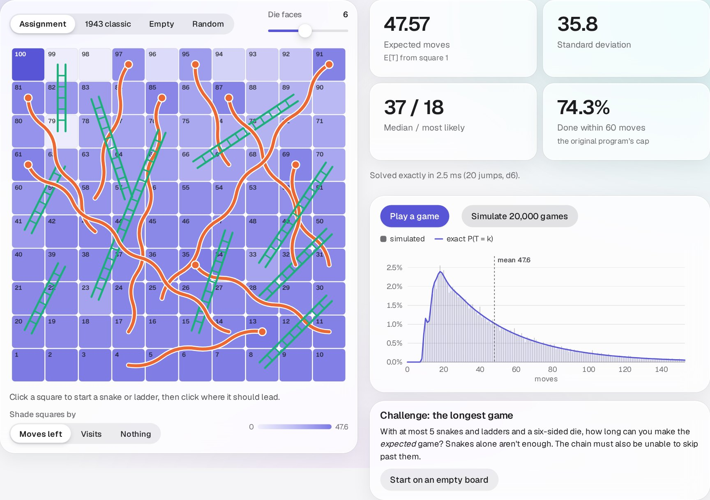
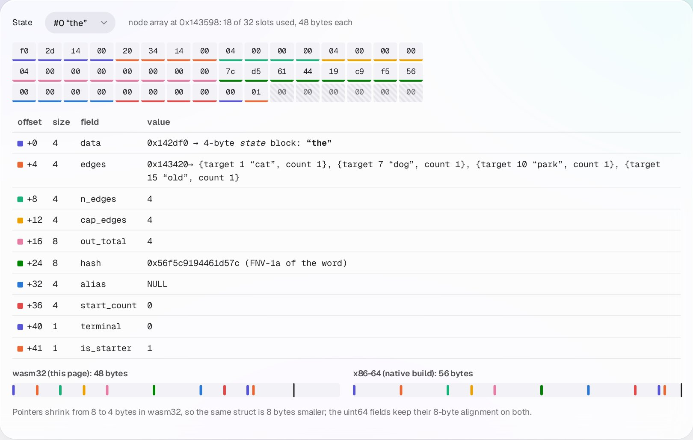
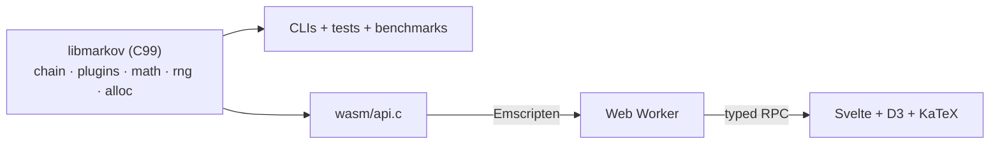

# Markov Chains: from the matrix to the metal

[](https://github.com/hasan-jwaied/markov-chains/actions/workflows/ci.yml)

**[Live demo →](https://hasan-portfolio-mauve.vercel.app/markov)**

A generic Markov chain engine in C99, **libmarkov**, compiled to WebAssembly
and wrapped in an interactive, explorable explanation of the mathematics. It
grew out of two exercises from the C course at the Hebrew University of
Jerusalem: a tweet generator, and a generic `void *` engine that also played
Snakes & Ladders.

<p align="center">
  
</p>

## Highlights

| | |
|---|---|
| **199× faster** to learn the original tweet corpus (2.51 s → 12.6 ms), **380×** on *Moby-Dick* | open-addressing state and edge indexes replace a linked-list scan: O(N·V) → O(N) |
| **133× faster** sampling at 4,096 successors (3.5 µs → 27 ns) | exact integer **Vose alias tables**, O(1) per draw |
| **Byte-identical** to the original program | a bit-exact **glibc `rand()`** re-implementation; golden output recorded from the untouched original is reproduced natively (21/21 cases) *and* in WebAssembly (18/18 engine cases) |
| **0 leaks** | tracked allocator; every unit test is a leak test; an **allocation-failure sweep** fails every allocation in turn |
| **Exact maths** | stationary distributions (power iteration on CSR), absorbing chains via **N = (I − Q)⁻¹** with partial-pivoting Gaussian elimination |
| **One codebase, four targets** | native CLIs, ASan/UBSan, Valgrind/gcov builds, and a 55 KB `.wasm` in a Web Worker |

## What's on the site

* **Learn**: six chapters, each pairing an idea with the C that computes it:
  the Markov property, learning `P` by counting (and why the matrix is 99.98%
  empty), weighted sampling and modulo bias, stationary distributions and
  periodicity, absorbing chains, and n-gram memory versus entropy.
* **Text Lab**: train an order-k chain on a novel in milliseconds; set the
  temperature; or *steer* it word by word from the live next-word distribution.
* **Snakes & Ladders Studio**: click to edit a board; the engine re-solves the
  exact expected game length from the fundamental matrix on every edit.
* **Guess the Chain**: infer a hidden transition matrix, and race the
  maximum-likelihood estimate.
* **Under the Hood**: vtables seen as WebAssembly function-table indices, a live
  view of the allocator, one struct decoded byte by byte (wasm32 against x86-64
  padding), and the benchmarks.

<p align="center">
  
  
</p>

## Engineering at a glance

| skill | where to look |
|---|---|
| Generic programming in C (`void *` + a hand-written vtable) | [`chain.h`](engine/include/markov/chain.h), [`plugins/`](engine/plugins) |
| Hash tables, amortised growth, all-or-nothing updates | [`chain.c`](engine/src/chain.c) |
| Randomised algorithms (alias method, unbiased bounded RNG) | [`alias.c`](engine/src/alias.c), [`rng.c`](engine/src/rng.c) |
| Numerical linear algebra | [`linalg.c`](engine/src/linalg.c), [`math.c`](engine/src/math.c) |
| Memory instrumentation and fault injection | [`alloc.c`](engine/src/alloc.c), [`test_faults.c`](tests/unit/test_faults.c) |
| Testing strategy (unit, golden, fuzz, sanitizers, Valgrind) | [`tests/`](tests), [`ci.yml`](.github/workflows/ci.yml) |
| A C ABI for WebAssembly, zero-copy views of linear memory | [`wasm/api.c`](wasm/api.c), [`engine.ts`](web/src/lib/engine/engine.ts) |
| Off-main-thread architecture, typed RPC | [`worker.ts`](web/src/lib/engine/worker.ts), [`client.svelte.ts`](web/src/lib/engine/client.svelte.ts) |
| Data visualisation (Svelte 5, D3, KaTeX) | [`web/src/lib/charts/`](web/src/lib/charts) |
| Design decisions | [`docs/adr/`](docs/adr) |

## Benchmarks

Native Release build, single thread
([full results](docs/BENCHMARKS.md)):

| corpus | words | original engine | libmarkov | speedup |
|---|---:|---:|---:|---:|
| Alice in Wonderland | 26,525 | 287 ms | 3.8 ms | **75×** |
| Tweet corpus (assignment) | 78,831 | 2.51 s | 12.6 ms | **199×** |
| Moby-Dick | 212,796 | 18.0 s | 47.2 ms | **380×** |
| Synthetic | 300,000 | 140.3 s | 90.6 ms | **1,548×** |

## Architecture



Details in [docs/ARCHITECTURE.md](docs/ARCHITECTURE.md). To add a new kind of
state (musical notes, dungeon rooms…), see [docs/PLUGINS.md](docs/PLUGINS.md).

```text
engine/        libmarkov: include/markov/*.h, src/, plugins/
apps/cli/      tweets_generator, snakes_and_ladders (original interfaces + --modern)
legacy/        the original assignment code, bug-fixed but otherwise as submitted
wasm/          the WebAssembly boundary (mkw_* C ABI)
web/           the site: Vite + TypeScript + Svelte 5 + D3 + KaTeX
tests/         unit/, golden/, cli/, fuzz/, wasm/
bench/         before/after benchmarks against the original engine
data/corpora/  the assignment's tweets + public-domain books
docs/          architecture, plugins, benchmarks, decision records
```

## Building

Requirements: CMake ≥ 3.21, a C99 compiler (gcc or clang); for the site,
[emsdk](https://emscripten.org/docs/getting_started/downloads.html) and
Node ≥ 20.19.

```sh
make            # build + test natively: unit, golden, CLI, fuzz smoke
make asan       # AddressSanitizer + UndefinedBehaviorSanitizer
make valgrind   # Valgrind, failing on any leak
make bench      # before/after benchmarks
make wasm       # engine -> web/src/wasm/markov.{mjs,wasm} (+ golden parity in Node)
make dev        # local site at http://localhost:5173/markov/
```

The CLIs keep the original interfaces and output:

```sh
./build/dev/apps/cli/tweets_generator 42 5 data/corpora/justdoit_tweets.txt
./build/dev/apps/cli/tweets_generator --modern --order 3 --sentence 7 5 data/corpora/gutenberg/alice.txt
./build/dev/apps/cli/snakes_and_ladders 1 3
./build/dev/apps/cli/snakes_and_ladders --analyze     # E[T] = 47.5712 from N = (I - Q)^-1
```

## From the original assignment

The submission is preserved at the tag
[`v0.0-baseline`](../../tree/v0.0-baseline) and, bug-fixed, in [`legacy/`](legacy).
The audit found and fixed:

* an **infinite loop** when every state is terminal (`get_first_random_node`);
* **silently split words** longer than the fixed 1,000-byte `fgets` buffer;
* **unchecked arguments** in Snakes & Ladders (`abc` and `-5` were accepted) and
  NULL dereferences on failed lookups;
* **O(N·V) learning** and **O(k²) array growth** (redesigned in libmarkov);
* **modulo bias** and global `rand()` state (an explicit RNG in libmarkov);
* one-word "dead-end" tweets (the `UNIFORM`/`EMPIRICAL` start policies).

The fixed legacy programs still match the original output on every golden
case. The analysis also showed that the original 60-move cap on random walks
cut off **25.7%** of Snakes & Ladders games.

## Credits

Books from [Project Gutenberg](https://www.gutenberg.org) (public domain); see
[data/corpora](data/corpora/README.md). The tweet corpus and the classic board
come from the original assignment.
