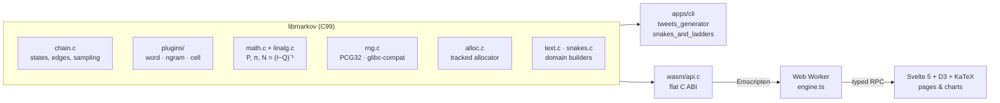

# Architecture



The same engine sources build three ways: natively for the CLIs, tests and
benchmarks; with ASan/UBSan, Valgrind or gcov for verification; and with
Emscripten for the browser. Nothing in `engine/` knows which.

## The engine

### Chains and states

`mk_chain` is opaque (`engine/src/chain_internal.h` has the layout). A state is
a dense `uint32_t` id (`mk_state`) that indexes `nodes[]`, so everything that
refers to a state (edges, matrices, analysis results) is a compact integer.

```text
mk_chain
├── nodes[]        mk_node per state: payload, edge array, totals, cached hash
├── slots[]        open-addressing index: hash(payload) -> id + 1
├── edge_keys[] /  open-addressing index: (from << 32 | to) -> position in
│   edge_pos[]     nodes[from].edges
├── starters[]     non-terminal states with a successor (uniform starts)
└── start alias    alias table over observed sentence openings
```

* **Interning is O(1) expected.** The original engine walked a linked list per
  word, so learning a corpus cost O(words × vocabulary).
* **Transition updates are O(1) expected.** Each edge array keeps insertion order
  (so the compat sampler reproduces the original byte for byte), and the global
  edge index finds an existing `(from, to)` pair without a scan.
* **Arrays grow geometrically (×2).** The original grew frequency arrays by one
  element per `realloc`, which is O(k²) copying.
* **Updates are all-or-nothing.** Every allocation an operation needs is
  reserved before any state changes, so `MK_ERR_NOMEM` leaves the chain exactly
  as it was. The fault-injection test checks this on every allocation site.

### Plugins (the vtable)

The chain never inspects payloads; it calls the seven functions of an
`mk_vtable` (`hash`, `compare`, `copy`, `destroy`, `is_terminal`, `format`,
plus a `name`). This is the original assignment's `void *` design, made
explicit and shared per type. See [PLUGINS.md](PLUGINS.md).

### Sampling

| sampler | cost per draw | used by |
|---|---|---|
| `MK_SAMPLE_LINEAR` | O(out-degree) cumulative scan | compat mode (bit-exact with the original) |
| `MK_SAMPLE_ALIAS` | O(1); O(d) lazy build, invalidated on update | default |
| tempered | O(d), weights `count^(1/T)` in log space | Text Lab temperature |

Alias tables are **exact integer** Vose tables: each column holds exactly
`W = Σ weights` units, so `P(i) = w_i / W` with no floating-point rounding,
and the tests check the tables exactly ([ADR 0003](adr/0003-integer-alias-tables.md)).

Start policies: `COMPAT` (the original rejection sampling, with the infinite
loop turned into `MK_ERR_NO_START`), `UNIFORM` (non-terminal states that have a
successor, which fixes the original's one-word "dead-end" tweets), and
`EMPIRICAL` (weighted by real sentence openings).

### Randomness

All sampling takes an explicit `mk_rng`, never the global `rand()`
([ADR 0004](adr/0004-explicit-rng-and-glibc-compat.md)):

* **PCG32**, with unbiased bounded draws (rejecting the `2^32 mod n` tail);
* **glibc-compat**, a bit-exact re-implementation of glibc's TYPE_3 `rand()`,
  plus the original `rand() % n`. It exists so the new CLIs, and the
  WebAssembly build (whose libc is musl), reproduce the original program's
  output exactly. Unit tests compare it with the real `rand()` for nine seeds,
  including seeds of 2³¹ and above, which glibc treats as negative.

### Memory

`mk_malloc`/`mk_free` prefix each block with a max-aligned header (size and
tag) and keep per-tag statistics, an optional observer hook and fault
injection (`mk_alloc_fail_after(n)`). The tests assert zero live blocks after
**every** test, and after **every** injected failure of a full pipeline. The
browser uses the hook to draw the live heap.

### Mathematics

* `mk_math_dense` / `mk_math_csr`: row-stochastic `P`. Absorbing states
  (terminal, no successors, or only a self-loop) get identity rows.
* `mk_math_stationary`: power iteration on CSR, with optional PageRank-style
  damping; reports iterations, L1 residual and convergence.
* `mk_math_absorbing`: canonical form, `I − Q` inverted by Gaussian elimination
  with partial pivoting, then `t = N1`, `Var = (2N − I)t − t∘t`, `B = NR`.
  It refuses chains where a transient state cannot reach an absorbing one
  (reverse BFS) and dense problems above 2,048 transient states.
* `mk_math_expected_steps`: sparse Gauss–Seidel for large chains, checked
  against the dense solver.
* `mk_math_absorption_pmf`: the exact distribution of the absorption time.

## The WebAssembly boundary

`wasm/api.c` is a flat C ABI (`mkw_*`) compiled with Emscripten
(`-sMODULARIZE -sEXPORT_ES6 -sALLOW_MEMORY_GROWTH`, no filesystem, 55 KB).

* Objects cross as opaque pointers (byte offsets into linear memory); JS frees
  what it creates.
* Fallible calls return `≥ 0` or `−mk_status`; 64-bit counts return as doubles.
* Bulk data is never copied in C: the TS layer views engine arrays through
  `HEAPU32`/`HEAPF64`. Those views are re-read on every access, because memory
  growth replaces them.
* `mkw_layout` reports `sizeof`/`offsetof` for every public struct, so the heap
  inspector decodes real memory without hard-coded offsets.

The same file also compiles natively under the strict warning set, so it
cannot rot between browser builds.

## The web app

```text
web/src/lib/engine/
  abi.ts            typed C exports
  layout.ts         struct layouts from mkw_layout
  engine.ts         Engine: model ids instead of pointers, typed results
  worker.ts         hosts the Engine in a Web Worker
  client.svelte.ts  Proxy-based RPC: every Engine method, but async
  model.svelte.ts   reactive model handles (rebuild on dependency change,
                    swap before free, discard stale builds)
```

* **One worker, one module.** Building a chain from a 1 MB novel never blocks
  input. Typed arrays are transferred, not copied. `$state` proxies are
  snapshotted before `postMessage`.
* **No threads.** WebAssembly threads need a cross-origin-isolated page
  (COOP + COEP headers), which would constrain the host site, so the engine
  stays single-threaded ([ADR 0005](adr/0005-no-threads.md)).
* **Charts** are hand-written Svelte + D3 SVG components sized to their
  container (one SVG unit = one pixel). Colours come from a validated
  categorical/sequential palette with separately chosen dark-mode steps.
  Every chart has a hover tooltip.

## Verification

| layer | how |
|---|---|
| engine | 40 unit tests (~1M checks), each a leak check; allocation-failure sweep |
| parity | 21 golden cases recorded from the untouched original binaries; legacy, new CLI and wasm must all match byte for byte |
| robustness | CLI behaviour tests (hang, long words, bad arguments), fuzz target (libFuzzer in CI, standalone driver locally) |
| memory | ASan + UBSan; Valgrind with `--errors-for-leak-kinds=all` |
| toolchains | gcc and clang, `-Wall -Wextra -Wpedantic -Wconversion -Werror` and more |
| web | `svelte-check`, Vitest running the real wasm engine in Node |
